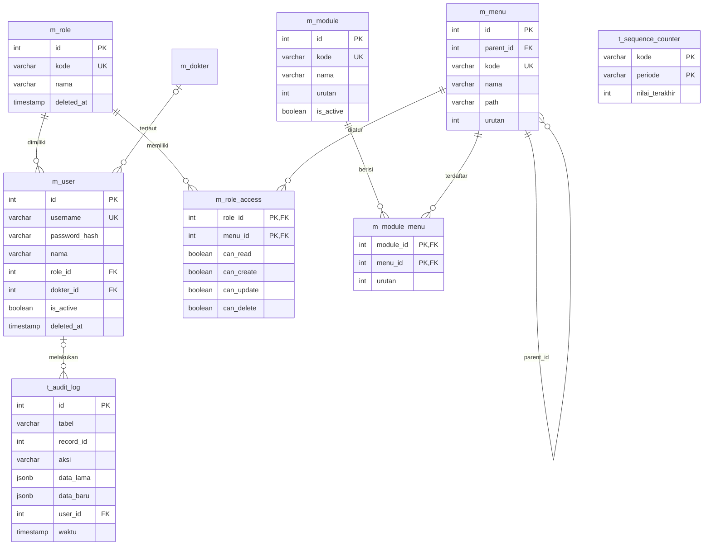
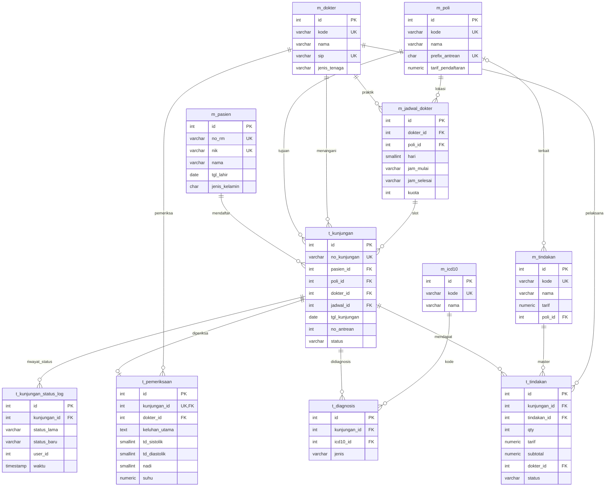
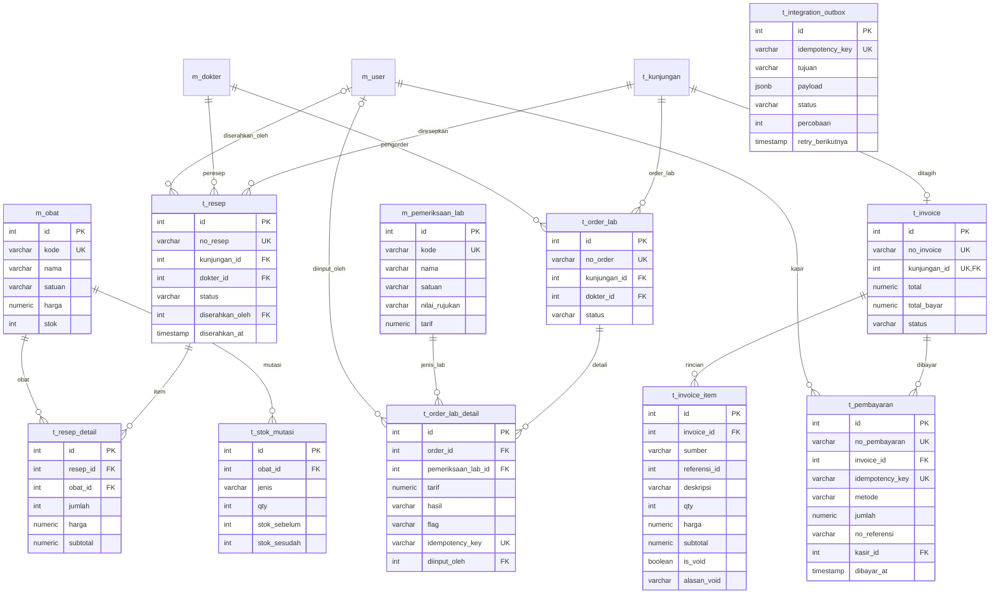

# Entity Relationship Diagram (ERD) — SIMRS Rawat Jalan

Skema lengkap PostgreSQL diekspor di [`database/schema.sql`](schema.sql) dan dikelola melalui migrasi Yii2 (`backend-yii/migrations/`). Seluruh 30 tabel bisnis (prefix `m_` untuk master dan `t_` untuk transaksi) memakai kolom audit standar (`created_at`, `updated_at`, `created_by`, `updated_by`), dan tabel master memakai soft delete (`deleted_at`).

## 1. Domain Sistem & Hak Akses

## 2. Domain Master Data & Pelayanan Klinis

## 3. Domain Farmasi, Penunjang (Lab), dan Billing

## 4. Constraint & Index Pengaman Utama

| Skenario | Tabel | Pengaman di PostgreSQL |
|---|---|---|
| D.1 Pendaftaran & antrean ganda | `t_kunjungan` | Partial unique `uq_t_kunjungan_pasien_poli_tgl_aktif` (`WHERE status <> 'batal'`), unique `uq_t_kunjungan_antrean (poli_id, dokter_id, tgl_kunjungan, no_antrean)` |
| D.2 Stok obat minus | `m_obat`, `t_resep` | `CHECK (stok >= 0)`, `CHECK (status <> 'diserahkan' OR diserahkan_at IS NOT NULL)` |
| D.3 Pembayaran ganda & overpay | `t_pembayaran`, `t_invoice` | Unique `uq_t_pembayaran_idempotency_key`, `CHECK (total_bayar >= 0 AND total_bayar <= total)` |
| D.4 Revisi tagihan | `t_invoice_item`, `t_audit_log` | Partial unique `uq_t_invoice_item_aktif (invoice_id, sumber, referensi_id) WHERE is_void = false`, `CHECK (NOT is_void OR length(trim(alasan_void)) > 0)` |
| D.5 Hasil lab tidak hilang/ganda | `t_order_lab_detail`, `t_integration_outbox` | Unique `uq_t_order_lab_detail_idempotency_key`, unique `uq_t_integration_outbox_idempotency_key`, index antrean `(status, retry_berikutnya)` |
| D.6 Optimasi dashboard | `t_kunjungan`, `t_invoice`, `t_pembayaran`, `t_tindakan`, `t_resep`, `t_invoice_item` | `idx_t_kunjungan_tgl_poli`, `idx_t_invoice_status`, `idx_t_pembayaran_dibayar_at`, `idx_t_tindakan_kunjungan_status`, `idx_t_resep_kunjungan_status`, `idx_t_invoice_item_invoice_sumber_aktif` |
