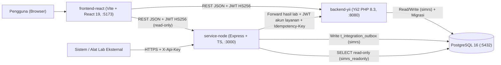
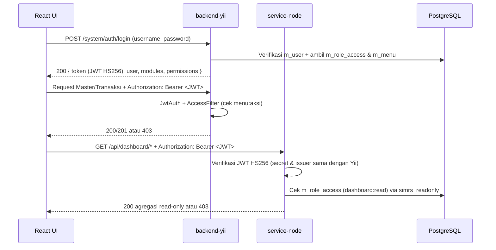
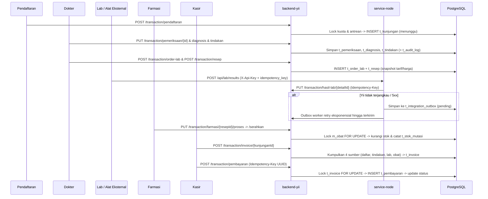

# Arsitektur Sistem dan Alur Komunikasi — SIMRS Rawat Jalan

Dokumen ini menggambarkan arsitektur komponen, batas tanggung jawab, protokol autentikasi, dan alur komunikasi end-to-end antara `frontend-react`, `backend-yii`, `service-node`, sistem eksternal laboratorium, dan `PostgreSQL`.

## 1. Diagram Arsitektur Komponen

## 2. Komponen Utama dan Port Lokal

| Komponen | Stack | Port | Tanggung Jawab Inti |
|---|---|---:|---|
| `frontend-react` | React 19, TypeScript, Vite, Tailwind, shadcn/ui, Zustand, i18next | `5173` | Antarmuka pengguna per role, validasi form, pembangkit `Idempotency-Key` pada form bayar, halaman cetak invoice/kwitansi |
| `backend-yii` | PHP 8.3, Yii2 REST API | `8080` | Seluruh business logic, validasi domain, autentikasi & RBAC menu, satu-satunya penulis data transaksi bisnis, pemilik migrasi database |
| `service-node` | Node.js, Express 5, TypeScript, Zod, pg | `3000` | Gateway integrasi hasil lab eksternal dengan pola transactional outbox + retry eksponensial, serta API agregasi dashboard read-only |
| `postgres` | PostgreSQL 16 | `5432` | Penyimpanan utama, pengaman integritas terakhir (unique, partial unique, check constraint, foreign key, row lock `FOR UPDATE`) |

## 3. Alur Autentikasi dan Hak Akses

## 4. Alur Pelayanan End-to-End (Pendaftaran sampai Billing)

## 5. Isolasi Koneksi dan Ketahanan

- **Single Writer untuk Data Transaksi**: hanya `backend-yii` yang menulis tabel `m_*` dan `t_*` (kecuali `t_integration_outbox` milik `service-node`).
- **Read-Only Isolation**: `service-node` menggunakan role PostgreSQL `simrs_readonly` untuk seluruh query dashboard sehingga secara struktural mustahil mengubah data transaksi.
- **Idempotensi Lintas Layanan**: pengiriman hasil lab (`t_order_lab_detail.idempotency_key` + `t_integration_outbox.idempotency_key`) dan pembayaran kasir (`t_pembayaran.idempotency_key`) aman terhadap retry jaringan dan klik ganda.
