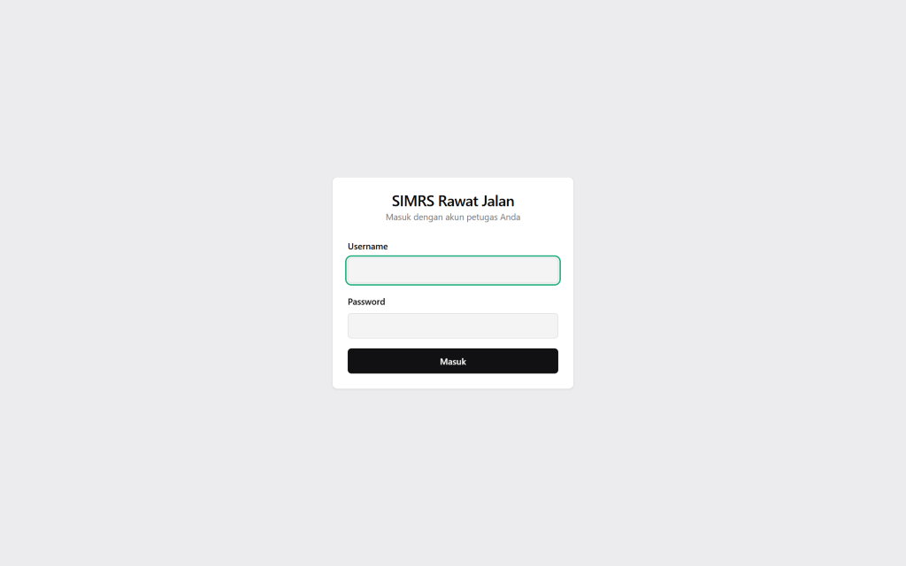
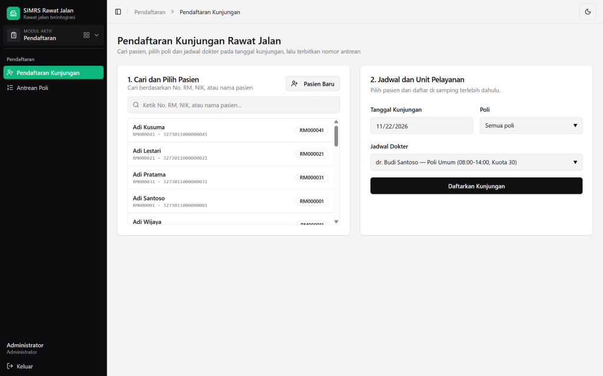
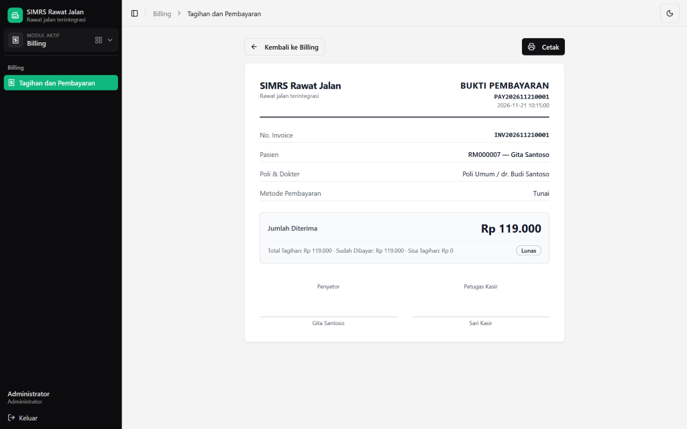
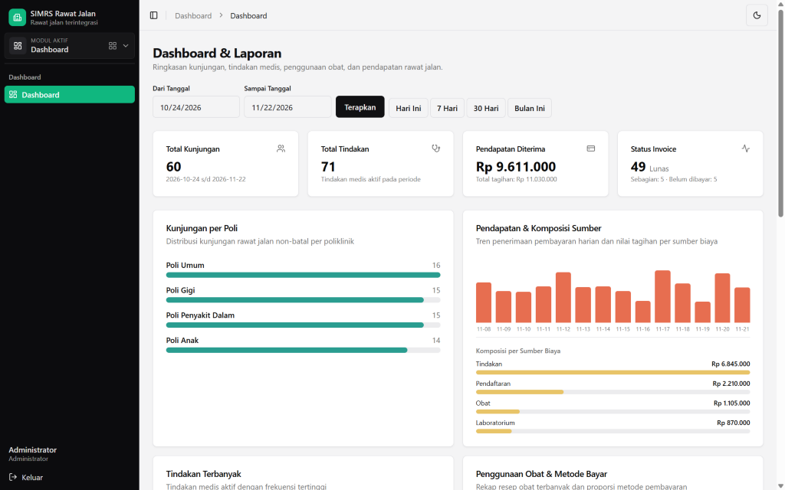

# Dokumentasi Screenshot Alur Pelayanan — SIMRS Rawat Jalan

Seluruh tangkapan layar diambil dari aplikasi lokal (`http://localhost:5173`) dengan data seed dummy end-to-end (`php yii seed`).

| No | Tahap | Tangkapan Layar |
|---:|---|---|
| 1 | Halaman Login |  |
| 2 | Pendaftaran Kunjungan |  |
| 3 | Antrean Poli |  |
| 4 | Pemeriksaan, Diagnosis, Tindakan, Resep, & Order Lab |  |
| 5 | Antrean & Penyerahan Farmasi |  |
| 6 | Worklist & Input Hasil Laboratorium |  |
| 7 | Billing, Pembayaran Bertahap, & Riwayat Pembayaran |  |
| 8 | Cetak Invoice Rawat Jalan (4 Sumber Biaya) |  |
| 9 | Cetak Bukti Pembayaran / Kwitansi |  |
| 10 | Dashboard & Laporan Periode (Node Read-Only) |  |
