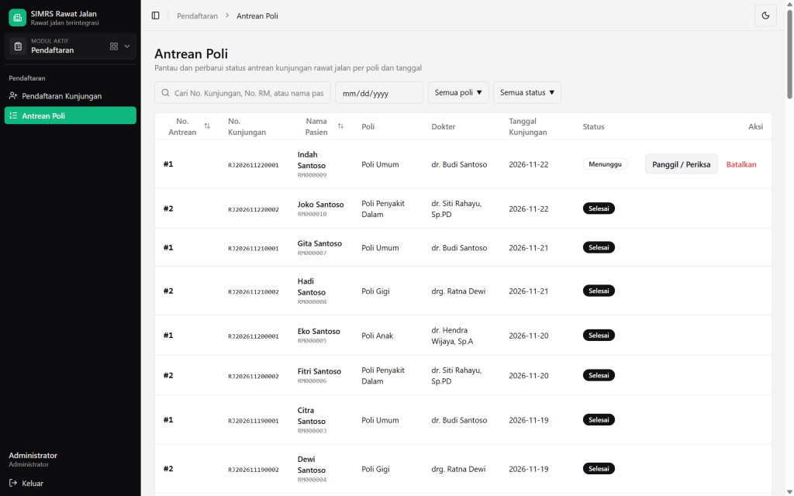
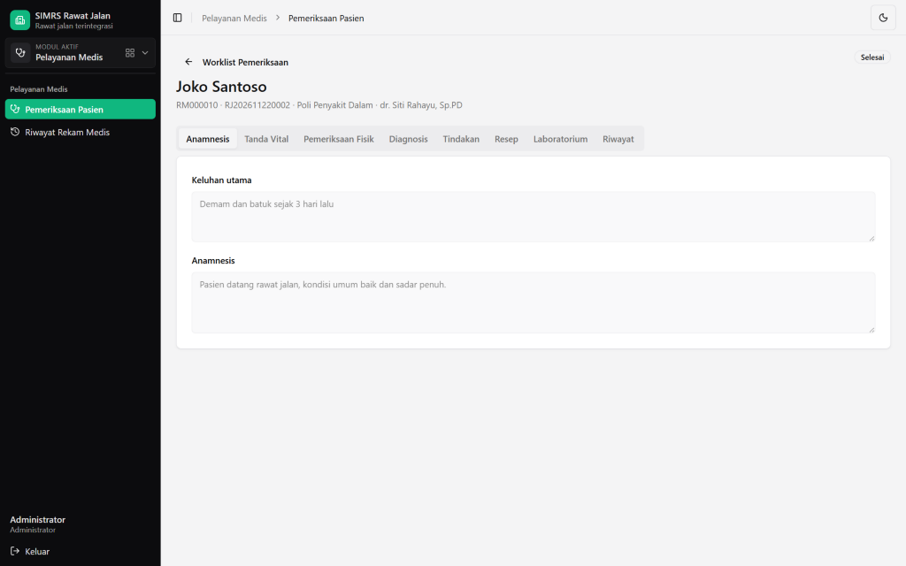
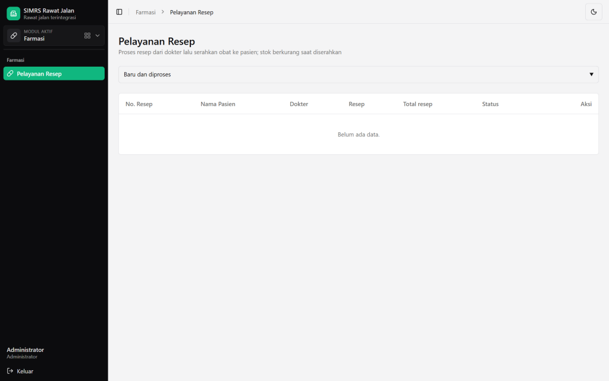
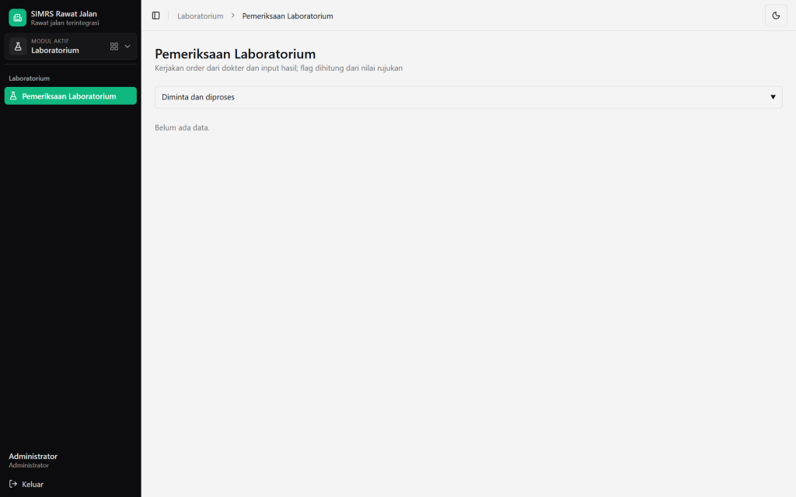
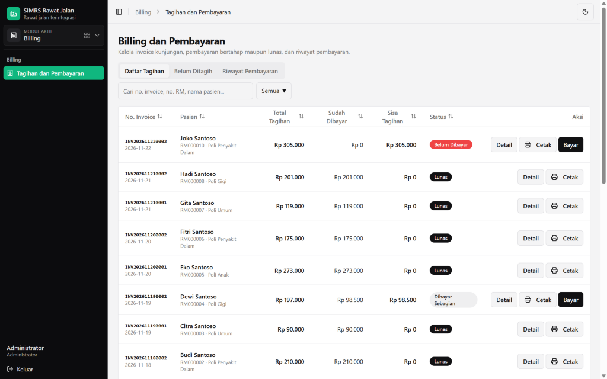
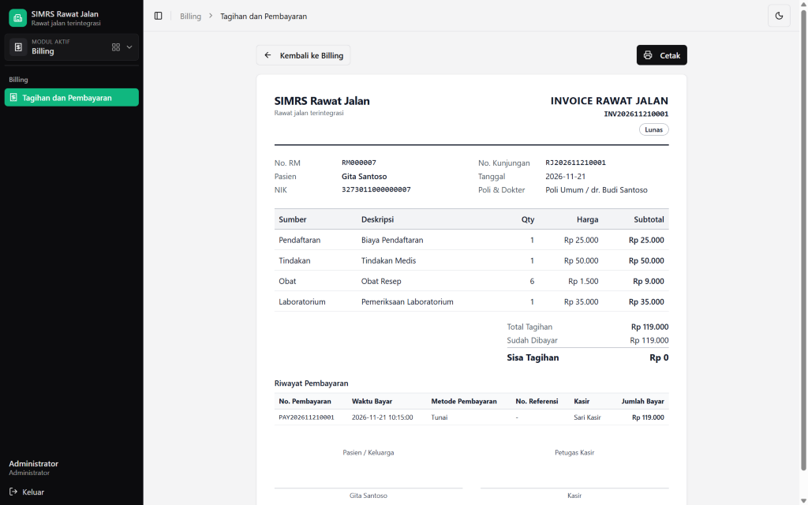

# Dokumentasi Screenshot Alur Pelayanan — SIMRS Rawat Jalan

Seluruh tangkapan layar diambil dari aplikasi lokal (`http://localhost:5173`) dengan data seed dummy end-to-end (`php yii seed`).

| No | Tahap | Tangkapan Layar |
|---:|---|---|
| 1 | Halaman Login |  |
| 2 | Pendaftaran Kunjungan |  |
| 3 | Antrean Poli |  |
| 4 | Pemeriksaan, Diagnosis, Tindakan, Resep, & Order Lab |  |
| 5 | Antrean & Penyerahan Farmasi |  |
| 6 | Worklist & Input Hasil Laboratorium |  |
| 7 | Billing, Pembayaran Bertahap, & Riwayat Pembayaran |  |
| 8 | Cetak Invoice Rawat Jalan (4 Sumber Biaya) |  |
| 9 | Cetak Bukti Pembayaran / Kwitansi |  |
| 10 | Dashboard & Laporan Periode (Node Read-Only) |  |

## Bukti Implementasi Backend Service Node.js

Respons di bawah diambil langsung dari service Node (`http://localhost:3000`) pada data seed tanggal 2026-11-24. Semua permintaan memakai `GET`, dan daftar panjang dipotong. Bukti uji Postman/Newman untuk endpoint Node (`/health`, `POST /api/lab/results`, dan `/api/dashboard/*`) ada di [`postman/newman-report.txt`](../../postman/newman-report.txt). Spesifikasi lengkapnya ada di [`docs/api/node.md`](../api/node.md) dan [`service-node/openapi.yaml`](../../service-node/openapi.yaml).

### 1. Integrasi laboratorium: daftar order untuk sistem eksternal (header `X-Api-Key`)

```text
GET /api/lab/orders -> HTTP 200
{
  "success": true,
  "message": "OK",
  "data": [
    {
      "order_id": 35,
      "no_order": "LAB202611220008",
      "status": "diminta",
      "catatan_klinis": "Mohon diperiksa, demam 3 hari, batuk pilek",
      "dibuat_at": "2026-11-22 13:29:04",
      "pasien": { "id": 181, "no_rm": "RM000058", "nama": "UJI AGEN Mobile Eka Putri" },
      "pemeriksaan": [
        { "detail_id": 38, "kode": "LAB001", "nama": "Hemoglobin", "satuan": "g/dL", "nilai_rujukan": "12-16", "hasil": null },
        { "detail_id": 39, "kode": "LAB005", "nama": "Leukosit", "satuan": "/uL", "nilai_rujukan": "4000-10000", "hasil": null }
      ]
    },
    "... 9 item lain"
  ]
}
```

### 2. Middleware autentikasi: API key tidak dikirim

```text
GET /api/lab/orders -> HTTP 401
{ "success": false, "message": "API key tidak valid atau tidak dikirim (header X-Api-Key)." }
```

### 3. Dashboard dan otorisasi data keuangan (`dashboard-keuangan`)

Role `admin` punya izin `dashboard-keuangan`, sehingga data keuangan tampil:

```text
GET /api/dashboard/summary?from=2026-11-24&to=2026-11-24 -> HTTP 200
{
  "success": true,
  "message": "OK",
  "data": {
    "periode": { "from": "2026-11-24", "to": "2026-11-24" },
    "total_kunjungan": 3,
    "total_tindakan": 1,
    "total_pendapatan": 267500,
    "total_tagihan": 0,
    "invoice_per_status": { "belum_dibayar": 0, "dibayar_sebagian": 0, "lunas": 0 }
  }
}
```

Role `dokter` tidak punya izin tersebut. Data operasional tetap tampil, tetapi data keuangan berisi `null`, dan endpoint keuangan ditolak:

```text
GET /api/dashboard/summary?from=2026-11-24&to=2026-11-24 -> HTTP 200
{
  "success": true,
  "message": "OK",
  "data": {
    "periode": { "from": "2026-11-24", "to": "2026-11-24" },
    "total_kunjungan": 3,
    "total_tindakan": 1,
    "total_pendapatan": null,
    "total_tagihan": null,
    "invoice_per_status": null
  }
}

GET /api/dashboard/pendapatan?from=2026-11-24&to=2026-11-24 -> HTTP 403
{ "success": false, "message": "Anda tidak memiliki akses ke fitur ini." }
```

### 4. Validasi request dan format error yang konsisten

```text
GET /api/dashboard/summary?from=2026-11-30&to=2026-11-01 -> HTTP 422
{
  "success": false,
  "message": "Validasi gagal.",
  "errors": { "to": ["Tanggal akhir harus sama atau setelah tanggal awal."] }
}
```

Perilaku outbox saat Yii tidak tersedia (balasan `202`, retry oleh worker, idempotensi) diuji otomatis di `service-node/tests/lab-integration.test.ts`.
